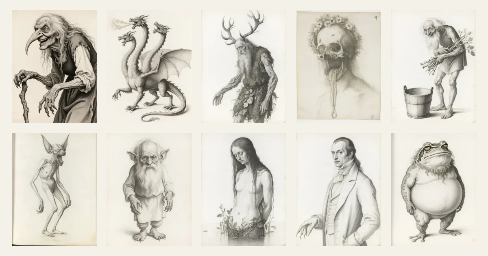

# Beasts

A field guide to Slavic folklore creatures, built so that every claim can be checked.
Each of the ten entries is a JSON file in which every clause carries a citation tag
(`afanasyev1868:p.326`) that resolves to a page of a public-domain source held in this
repository. Each entry has a monochrome silverpoint plate.



**Scope.** One test per creature: is anyone alive today supposed to be praying to it? If
yes, it is out, so the pre-Christian gods (Perun, Veles, Mokosh and the rest) and modern
neopagan reconstructions are excluded; folk creatures and spirits that were feared,
avoided or appeased are in.

## Using the data

- **Entries:** `data/entries/<id>.json`, one file per creature, validated against
  `schema/entry.schema.json`. The book site also serves them as static JSON:
  `/data/slavic/index.json`, `/data/slavic/<id>.json`,
  `/data/schema/entry.schema.json` and `/data/LICENSE`.
- **Plates:** `plates/slavic/<id>.web.webp` and `<id>.thumb.webp`, with each plate's
  prompt, model, seed and cost in `plates/slavic/<id>.json`. The plates are drawings
  after the folk tradition, not reconstructions from the sources; every entry marks its
  plate `image.interpretive: true`.
- **Sources:** `sources/manifest.json` lists the eleven public-domain works in the
  corpus, with each one's edition, origin (archive.org item or Wikisource page) and
  public-domain reason. `npm run cite -- <tag>` prints the page a tag points to.
- **Licences:** code is MIT (`LICENSE`). The dataset, meaning `data/`, `plates/slavic/`
  and `schema/`, is CC BY 4.0 (`LICENSE-DATA`). The corpus under `sources/pages/` and the
  style references under `style/refs/` are public domain (`sources/README.md`).
- **Cite as:** *Beasts: a field guide to Slavic folklore creatures*, v0.1.0, by brac
  (2026), https://github.com/brac/beasts, CC BY 4.0.

## How it was made

A draft agent reads the cited sources and fills every schema field, tagging each clause
with its source and page and leaving a field empty rather than writing an untagged claim.
A second agent that has not seen the draft reads the cited passages, removes what the
source does not say, and assigns one of four attestation grades. The plates were
generated with one image model in a single fixed style and each was approved by eye. The
full method, with the reasons and the rejected alternatives, is on the site's `/method`
page; the plate style is specified in `style/STYLE-SHEET.md`, and the decision log is
`docs/BACKLOG.md`.

## Scripts

| Script | Command | Purpose |
| --- | --- | --- |
| `typecheck` | `tsc --noEmit` | Type check `src` and `test` |
| `test` | `vitest run` | Run unit tests |
| `check` | `npm run typecheck && npm test && npm run site:test` | Typecheck, unit tests, then the site build and its tests |
| `validate` | `tsx src/validate/cli.ts` | Validate entries or verify logs |
| `corpus:fetch` | `tsx src/corpus/fetch.ts` | Download raw source files |
| `corpus:build` | `tsx src/corpus/build.ts` | Build per-page JSONL under `sources/pages/` |
| `corpus:verify` | `tsx src/corpus/verify.ts` | Check corpus hashes against the manifest |
| `cite` | `tsx src/corpus/cite-cli.ts` | Resolve a citation tag to page text |
| `find` | `tsx src/corpus/find-cli.ts` | Search the corpus for a term |
| `stats` | `tsx src/report/stats.ts` | Print per-creature pilot statistics and the reconciliation check |
| `plates` | `tsx --env-file-if-exists=.env src/plates/generate.ts` | Generate plate candidates (spends money; needs `FAL_KEY` in `.env`) |
| `plates:finalise` | `tsx src/plates/finalise.ts` | Rebuild plate sizes and `image` fields from `plates/picks.json` |
| `site:dev` | runs in `site/` | Start the book site's dev server |
| `site:build` | runs in `site/` | Build the static site |
| `site:preview` | runs in `site/` | Serve the built site locally |
| `site:test` | runs in `site/` | Build the site, then run its tests against the build |
| `site:contact-sheet` | runs in `site/` | Write `docs/contact-sheet.webp`, the contact sheet of the plate thumbnails |

## Running the site

The book site is an Astro project in `site/` with its own `package.json`. It reads the
entries and plates from `data/` and `plates/slavic/` at build time and holds no copy of
them.

```sh
npm install
npm install --prefix site
npm run site:dev      # or: npm run site:build && npm run site:preview
```

## Reporting an error

If a clause is wrong, unsupported, or cites the wrong page, open an issue with the
**Entry correction** template. It asks for the entry id, the clause quoted exactly, its
cite tag, the correction, and a source for the correction.
