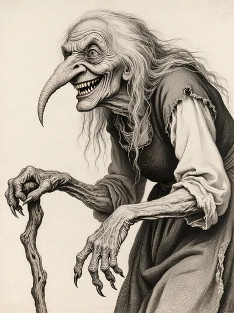
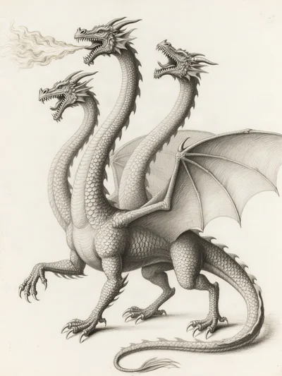
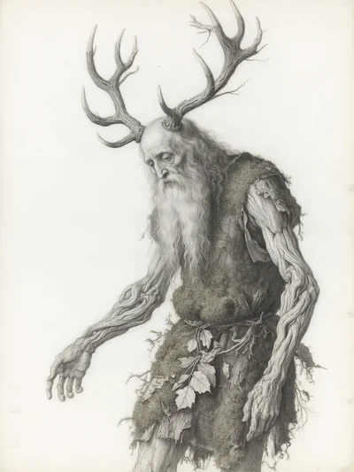
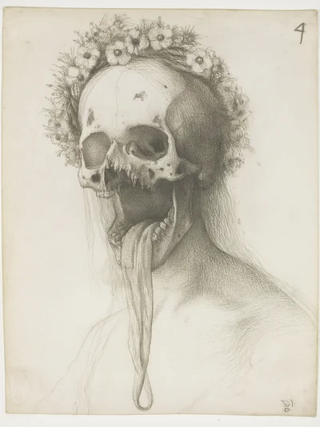
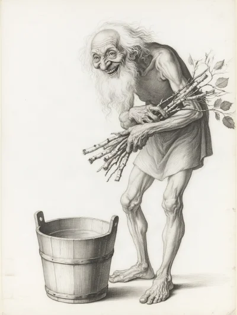
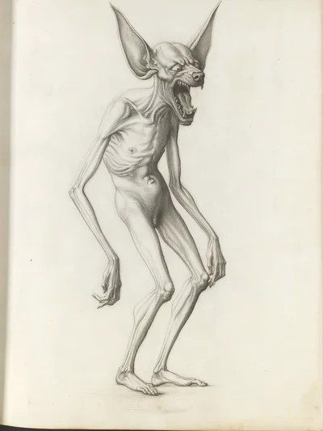
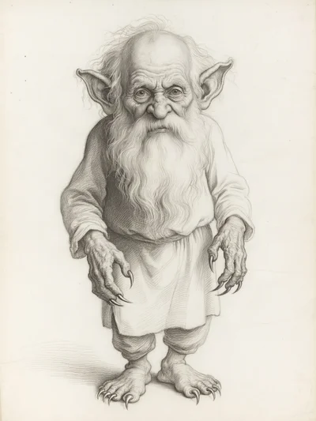
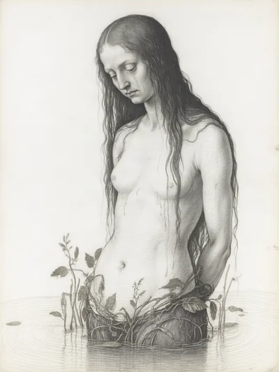
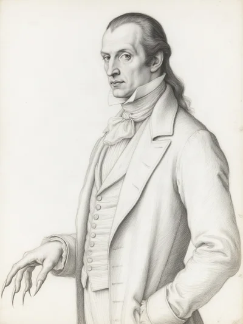
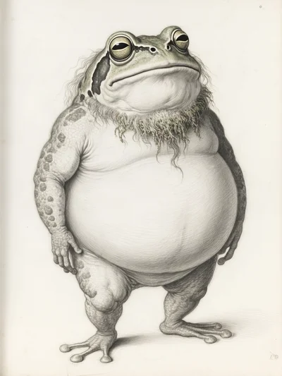

# Old Wives plate style sheet (volume 1, Slavic pilot)

This sheet lets a later volume match the ten Slavic plates without re-deriving anything.
Each rule here was settled by Ben during Phase 2. The reasons and the rejected
alternatives are in `docs/BACKLOG.md` and the amendments in `plans/phase-2.md`.

## The ten plates

| | | | | |
| --- | --- | --- | --- | --- |
|  Baba Yaga |  Zmey Gorynych |  Leshy |  Poludnitsa |  Bannik |
|  Drekavac |  Domovoi |  Rusalka |  Vampir |  Vodyanoi |

Each plate's prompt, model, seed, cost and edits are recorded in its entry's `image`
field and in `plates/slavic/<id>.json`. `npm run plates:finalise` rebuilds the sizes and
fields from `plates/picks.json`.

## Why silverpoint

The idiom is a Renaissance silverpoint study, after Leonardo da Vinci's metalpoint
sketches. It is drawn, not printed or painted, and it is sharper and higher in contrast
than the originals. A study suits a bestiary built from sources. It reads as an observer's
attempt to record a thing, not as a finished fantasy illustration. The fine grey line
holds detail at thumbnail size, and one medium keeps ten very different creatures
looking like one book. Monochrome also removes a whole class of drift: every round that
let colour in looked more like concept art and less like a study.

Rejected:
- lubok, as too old-world;
- the Grimm television show's illustrations, as too amateur;
- pen-and-ink engraving;
- a short colour palette. Colour was tried and dropped on 2026-10-27: monochrome only.

## Format

- **Medium:** monochrome silverpoint. Fine grey lines, hatching and cross-hatching, with
  the strokes following the form.
- **Palette:** grey to near-black line on a plain light or off-white ground. There is no
  colour, no tint and no spot colour. A slight warm cast in the paper is acceptable.
  Ben prefers off-white to pure white.
- **Composition:** a single figure, as a character study: the whole body from head to
  feet in the frame, isolated on blank paper. There is no background, no scenery and
  no interior. A prop belonging to the creature is allowed (Bannik's bucket, the
  Poludnitsa's sickle). Vampir is the one half-length portrait.
- **Lettering:** none. There is no script, caption, signature, border or construction
  grid.
- **Sizes:**
  - native output: 1104 x 1472 (3:4 portrait), never upscaled;
  - web copy: `<id>.web.webp` at native size;
  - thumbnail: `<id>.thumb.webp`, 400 px wide;
  - the full-size PNG is kept locally and never committed (R2 storage comes later).

## Model and settings (locked)

- **Model:** Qwen-Image on fal (`fal-ai/qwen-image`), with Apache-2.0 weights, at
  $0.04 per plate.
- **Settings:**
  - style `a`;
  - guides off;
  - plain paper;
  - `style_tokens_version` = `a-2026-10-27`.
- **Bake-off:** 2026-10-27, blind, on baba-yaga, bannik and zmey-gorynych. The private
  contact sheet is https://claude.ai/artifact/ViHt2znTMHZaGLv4Z7J2NB. The losers:
  - **Z-Image:** good hatching, nonsensical structure.
  - **FLUX.1 schnell:** the most complete, but it shows AI artefacts and reads as a
    tattoo.
  - **Qwen edit with reference images:** it copied the reference drawing.
- **Style b:** "silverpoint drawing, metalpoint, … plain empty background". Rejected
  because it read as uncanny photorealism. The word "study" keeps the plates sketch-like.

## Prompt recipe

A plate prompt has three parts, joined in this order.

1. **Opening style sentence**, at the head of every subject text:

   > A monochrome silverpoint character study: a single figure alone on plain off-white
   > paper, drawn only in fine grey metalpoint lines and hatching, like a page from a
   > Renaissance master's sketchbook.

2. **Subject.** For the pilot, this is Ben's visual-tradition description in
   `plates/overrides.json` (`visual.text`, marked `interpretive`). The entry's sourced
   appearance clauses stay unchanged in the dataset. Full-figure plates end with: "Full-length
   figure: the whole body from head to feet inside the frame, isolated on blank paper."

3. **Style tokens** (from `src/plates/prompt.ts`), appended:

   > silverpoint study, metalpoint drawing, Renaissance sketch, hatching and
   > cross-hatching, fine line, high contrast, sharp focus, monochrome, clean light paper
   > ground

**Negative prompt.** These are bare nouns, never "no X":

> painterly fantasy concept art, 3D render, digital painting, colour, color, smooth
> shading, anime, comic book inking, photograph, text, watermark, border, handwriting,
> inscriptions, annotations, script, lettering, captions

The visual-tradition plates add the following, plus each creature's own `negative_extra`:

> photorealism, photograph, colour painting, oil painting, background, scenery,
> landscape, interior, room

## What the model does with words (lessons from five review rounds)

- **Naming something draws it.**
  - "no construction grid" drew a grid.
  - Describing fangs, even subtle ones, drew bad teeth.
  - "no bigger than a house cat" put a cat beside the Domovoi.

  To suppress something, leave it out of the positive prompt. Then add it as a bare noun
  to the negative.
- **A named setting pulls in colour and photorealism.** A stove, a bathhouse or a lake's
  edge each turned the plate into a painted scene. Style words placed only at the end
  lose to a vivid subject, which is why the style sentence opens the prompt.
- **Quoted names and asides become lettering.** The prompt sanitiser strips quotes,
  parentheticals and proper names (`src/plates/prompt.ts`).
- **Say the anatomy plainly.**
  - "Chicken legs" drew bird legs. "Reverse-jointed legs, the knee bending backward
    like a dog's hind legs" drew the intended shape.
  - "Skeletal" drew bare bones. Write "starved, skin stretched tight, fleshed" when the
    creature should be gaunt.
- **Read the subject at the right weight.** "A man with frog features" read as a man in
  a frog mask. "A big, blobby frog creature, only vaguely human" read as intended.
  Lead with what the creature mostly is.

## How a plate is chosen

1. Draw two seeds per creature.
2. Show them to Ben on a private review sheet, beside about six popular reference
   images from Google Images. The references are copyrighted. They stay local in the
   gitignored `plates/refs/`, are never sent to the model, and never enter the dataset.
3. Ben writes notes. These become edits to `visual.text` and `negative_extra`, each
   with a dated `note` giving his reason.
4. Redraw until Ben approves.

Agents check only mechanics:
- the size;
- the sidecar flags;
- a tint share (the share of pixels with chroma above 0.12 on a 16 px grid), shown for
  information only.

Ben is the only visual judge. The brief's automated vision check was replaced by his
review.

The pilot generated 126 images across the bake-off, the test grid and five review rounds, and spend reached $5.21 of the $25 cap.

## Style references (public domain, `style/refs/`)

These are style references only, never subject references, and none is sent to the
model.

- **2. Leonardo da Vinci**, *A study of a woman's hands*, c.1490. Royal Collection
  Trust, RCIN 912558. PD-Art.
- **3. Albrecht Dürer**, *Self-Portrait at Thirteen*, 1484. Albertina, Vienna. PD-Art.
- **5. Hans Holbein the Elder**, *The head of a crossbowman taking aim*, c.1514–15.
  Statens Museum for Kunst. PD-Art.

Source pages, hashes and the candidates that were not chosen are in
`style/refs/manifest.json`.
